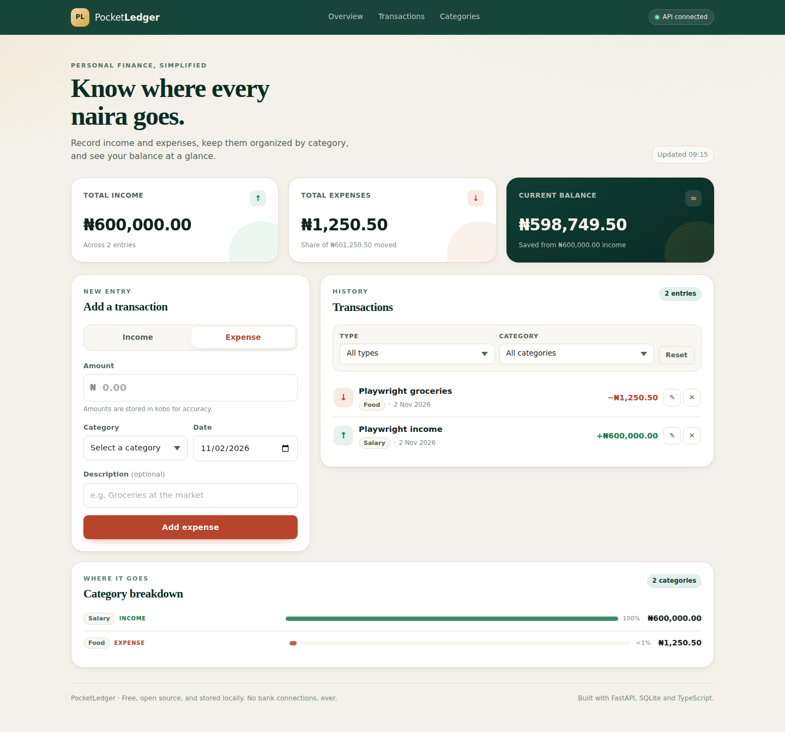
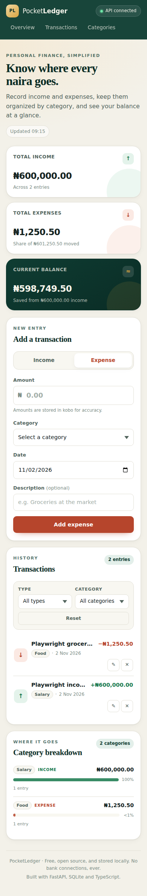
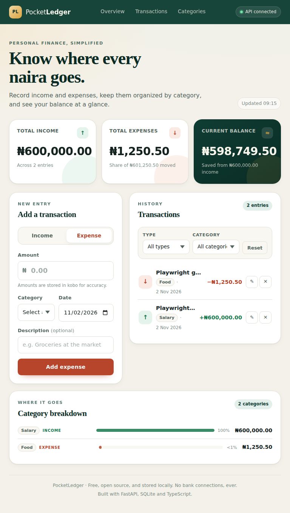

# PocketLedger

PocketLedger is a small, private income and expense tracker. It pairs a
responsive TypeScript dashboard with a FastAPI + SQLite backend so you can log
transactions, organize them by category, and see where your money is going.
Everything is stored locally in a single SQLite file — no accounts, no bank
connections, no paid services.


## Screenshots

Captured by the Playwright suite against the production build, using a
disposable demo database.

| Desktop — 1440 px | Mobile — 390 px |
| --- | --- |
| [](docs/screenshots/desktop-1440.png) | [](docs/screenshots/mobile-390.png) |
| Tablet — 768 px | Summary and ledger |
| [](docs/screenshots/tablet-768.png) | Form, filters, category bars and API status |

## Features

- Add income and expense transactions with amount, date, description and category.
- Edit or delete any existing transaction.
- 14 built-in categories (Salary, Food, Transport, Housing, Utilities, …).
- Summary cards for total income, total expenses and current balance.
- Filter the transaction history by type and category.
- Category breakdown with CSS progress bars (no charting library).
- Loading skeletons, empty states, inline validation and retryable error states.
- Accessible, mobile-first dashboard: labelled controls, keyboard-friendly type
  toggles, `aria-live` feedback, obvious focus rings and reduced-motion support.
- Integer money handling in minor units (kobo/cents) to avoid floating-point drift.
- Configurable API base URL, display currency and locale.

## Tech stack

| Layer     | Tools                                                       |
| --------- | ----------------------------------------------------------- |
| Frontend  | HTML5, CSS3, TypeScript (strict), Vite                      |
| Backend   | Python 3.11+, FastAPI, Pydantic, Uvicorn                    |
| Database  | SQLite via Python's built-in `sqlite3` (parameterized SQL)  |
| Tests     | pytest + FastAPI `TestClient`, Playwright (Chromium)         |
| CI        | GitHub Actions (pytest, typecheck, build, browser tests)    |

Dependencies are free and open source. No external APIs, analytics or fonts.

## Project structure

```
PocketLedger/
├── backend/
│   ├── main.py             # FastAPI app, routes, CORS
│   ├── database.py         # SQLite schema, queries, summary aggregation
│   ├── models.py           # Pydantic request/response models + validation
│   ├── requirements.txt
│   └── pocketledger.db     # created on first run (gitignored)
├── frontend/
│   ├── index.html          # dashboard markup and states
│   ├── src/main.ts         # UI state, rendering, form & filter logic
│   ├── src/api.ts          # typed API client with error handling/timeouts
│   ├── src/types.ts        # shared TypeScript contracts
│   ├── src/styles.css      # mobile-first responsive design system
│   ├── e2e/
│   │   └── pocketledger.spec.ts  # browser regression suite
│   ├── playwright.config.ts
│   ├── .env.example
│   ├── tsconfig.json       # strict mode
│   ├── vite.config.ts
│   └── package.json
├── tests/
│   ├── conftest.py         # temp-DB fixture
│   ├── test_transactions.py
│   └── test_summary.py
├── docs/screenshots/       # authentic Playwright captures
├── .github/workflows/ci.yml
├── pytest.ini
├── LICENSE
└── README.md
```

## Local development

### Prerequisites

- Python 3.11 or newer
- Node.js 20.19+ / 22.12+ (Node 22 recommended) and npm

### 1. Backend

From the repository root:

```bash
python3 -m venv backend/.venv
source backend/.venv/bin/activate          # Windows: backend\.venv\Scripts\activate
pip install -r backend/requirements.txt

cd backend
uvicorn main:app --reload --port 8000
```

The API is now at <http://localhost:8000>, interactive docs at
<http://localhost:8000/docs>, and the health check at
<http://localhost:8000/api/health>. The SQLite database
`backend/pocketledger.db` is created automatically on startup.

### 2. Frontend

In a second terminal:

```bash
cd frontend
npm install
cp .env.example .env        # optional; defaults match local development
npm run dev
```

Open <http://localhost:5173>. The default API URL is `http://localhost:8000`;
change `VITE_API_BASE_URL` in `frontend/.env` if your backend runs elsewhere.
Restart Vite after editing environment variables.

### Useful commands

| Command | Location | Purpose |
| --- | --- | --- |
| `uvicorn main:app --reload` | `backend/` | Run the API with hot reload |
| `python -m pytest` | root | Run backend tests against a temp DB |
| `npm run dev` | `frontend/` | Vite dev server |
| `npm run typecheck` | `frontend/` | TypeScript strict check |
| `npm run build` | `frontend/` | Typecheck + production build to `frontend/dist/` |
| `npm run preview` | `frontend/` | Serve the production build on port 4173 |
| `npx playwright install chromium` | `frontend/` | Download the browser (once) |
| `npm run test:e2e` | `frontend/` | Run browser tests against a disposable DB |

## API reference

Base URL: `http://localhost:8000`

| Method | Endpoint | Description | Success |
| --- | --- | --- | --- |
| `GET` | `/api/health` | Service and database status | `200` |
| `GET` | `/api/transactions` | List transactions, newest first | `200` |
| `POST` | `/api/transactions` | Create a transaction | `201` |
| `PUT` | `/api/transactions/{id}` | Replace a transaction | `200` |
| `DELETE` | `/api/transactions/{id}` | Delete a transaction | `204` |
| `GET` | `/api/summary` | Totals, balance and category breakdown | `200` |
| `GET` | `/api/categories` | Allowed category names | `200` |

`GET /api/transactions` accepts optional filters:

- `type` — `income` or `expense`
- `category` — any canonical category, case-insensitive
- `limit` — 1–1000, default 500

Unknown IDs return `404`, invalid payloads return `422`, and requests with a
missing database return `503` from the health endpoint.

### Transaction payload

```json
{
  "type": "expense",
  "amount_minor": 125050,
  "category": "Food",
  "description": "Groceries",
  "date": "2026-10-31"
}
```

Validation rules:

- `type` must be `income` or `expense`.
- `amount_minor` must be a positive integer (maximum 100,000,000,000).
- `category` must be one of the allowed categories; casing and whitespace are normalized.
- `description` is trimmed and limited to 200 characters.
- `date` must be a valid ISO date (`YYYY-MM-DD`) that is not in the future.
- Updates (`PUT`) require the full payload, matching create semantics.

### Summary response

```json
{
  "currency": "NGN",
  "income_total_minor": 56000000,
  "expense_total_minor": 13525050,
  "balance_minor": 42474950,
  "transaction_count": 4,
  "by_category": [
    { "category": "Salary", "type": "income", "total_minor": 50000000, "transaction_count": 1 },
    { "category": "Housing", "type": "expense", "total_minor": 12000000, "transaction_count": 1 }
  ]
}
```

## Your data stays local

Transactions are written to `backend/pocketledger.db`, a SQLite file on your
machine. The directory is listed in `.gitignore`, so personal ledger data is
never committed. Delete the file while the backend is stopped to start fresh.
Automated tests override `POCKETLEDGER_DB` and use throwaway files under
`/tmp` (backend) or pytest's `tmp_path`, so they never touch your real ledger.
There is no cloud sync and no external financial service receives your data.

## Money handling

Amounts travel through the API, database and JavaScript state as **integer
minor units** (kobo for NGN, cents for other currencies). The UI converts a
decimal input such as `1,250.50` to `125050` using string arithmetic, never
`parseFloat`, and formatting is done with `Intl.NumberFormat`. Currency
symbols are never used in calculations; the symbol shown in the amount field is
derived from the configured currency code.

`NGN` is the default, configured via `VITE_CURRENCY` on the frontend and
`POCKETLEDGER_CURRENCY` in the `/api/summary` response.

## Configuration

| Variable | Default | Where | Purpose |
| --- | --- | --- | --- |
| `VITE_API_BASE_URL` | `http://localhost:8000` | frontend | Backend base URL |
| `VITE_CURRENCY` | `NGN` | frontend | ISO 4217 display currency |
| `VITE_LOCALE` | `en-NG` | frontend | Formatting locale |
| `POCKETLEDGER_DB` | `backend/pocketledger.db` | backend | SQLite file path |
| `POCKETLEDGER_CURRENCY` | `NGN` | backend | Currency reported by summary |
| `POCKETLEDGER_CORS_ORIGINS` | `http://localhost:5173,http://127.0.0.1:5173` | backend | Comma-separated allowed origins |

## Testing

Run the backend suite from the repository root:

```bash
backend/.venv/bin/python -m pytest        # or: python -m pytest
```

Each test gets its own SQLite file under pytest's `tmp_path`; the development
database is never touched. The suite covers:

- Health check and CRUD behaviour (status codes, 404s, ordering).
- Type/category filtering and invalid filter values.
- Pydantic validation: zero/negative/non-integer amounts, bad types, unknown
  categories, missing fields, future dates and over-long descriptions.
- Income, expense and balance totals, category aggregation, repeat categories
  in integer minor units, and summary updates after edits/deletes.

Frontend checks:

```bash
cd frontend
npm run typecheck
npm run build
```

Browser tests (real Chromium via Playwright):

```bash
cd frontend
npx playwright install chromium   # first run only
npx playwright install-deps chromium  # Linux system libraries, first run only
npm run test:e2e
```

`playwright.config.ts` starts Uvicorn (with a disposable `/tmp` database) and
the production preview server automatically. The suite covers adding income
and expenses, editing, deleting, balance math, category/type filtering,
validation errors, persistence after refresh, API-failure recovery, and layouts
at 390 px, 768 px and 1440 px. It also writes the README screenshots.

CI (`.github/workflows/ci.yml`) runs three jobs on pushes and pull requests to
`main`: Python 3.11 with pytest, Node 22 with typecheck + production build, and
Node 22 with Chromium browser tests.

## Design notes

- Mobile-first CSS with breakpoints at 560 px, 760 px and 1024 px.
- The form becomes sticky beside the ledger on desktop; summaries stack on phones.
- Type toggle uses real radio inputs with visible focus styling for keyboard users.
- Transaction rows expose edit/delete actions with descriptive `aria-label`s;
  deletions require confirmation.
- All API failures surface a human-readable message and a retry action.
- No authentication, bank integrations or third-party tracking by design.

## Limitations

- **Do not expose this API publicly.** It has no authentication or access
  control, so anyone who can reach a writable deployment could read or modify
  the ledger. The project is intended for local, single-user use.
- Single-user and local-only; there is no multi-device sync or user accounts.
- No pagination beyond the server-side `limit` (default 500), and no recurring
  transactions, budgets or advanced reports.
- Dates are plain calendar dates without timezone conversion.
- Browser tests currently cover Chromium only.
- Not intended for real banking, tax or accounting use.

## License

[MIT](LICENSE)
